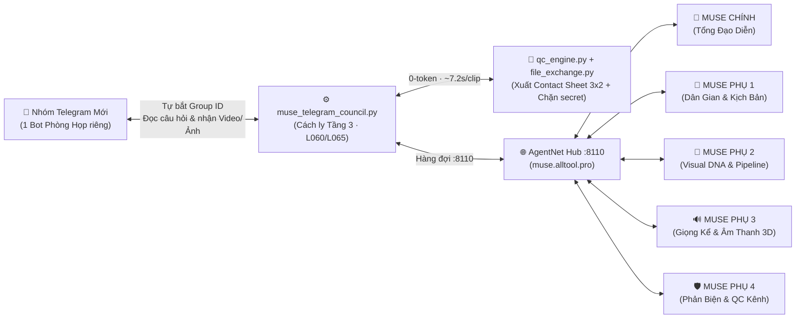

# 👻 Phiên Họp Bàn Tròn Đa Muse: Làm Video Truyện Ma Dân Gian Việt Nam

> [!IMPORTANT]
> **Bằng chứng thực thi thật (`L016`):** Toàn bộ **6 nhiệm vụ nghiên cứu – phản biện – tổng hợp** đã được **5 phiên `muse.ai` độc lập** thực thi trên Sảnh `AgentNet Hub :8110` (`session: ghost-vn-20261124`). Đầy đủ **7/7 lượt phát biểu** đang nằm sẵn trong hàng đợi `outbox` của [muse_telegram_council.py](file:///D:/AI_AGENT/AI_SYSTEM/RAG/muse_telegram_council.py) và bản ghi đầy đủ tại [2026-11-24_BAN_TRON_MUSE_TRUYEN_MA_DAN_GIAN_VN.md](file:///D:/AI_AGENT/AI_SYSTEM/RAG/notes/2026-11-24_BAN_TRON_MUSE_TRUYEN_MA_DAN_GIAN_VN.md).

## 1. Sơ đồ Luồng Phòng Họp & QA/QC 2 Chiều Đã Dựng

---

## 2. Tóm tắt Kết quả Bàn Tròn 2 Vòng (Giữa Muse Chính & 4 Muse Phụ)

| Vai trò | Đề xuất cốt lõi (Vòng 1) | Điểm bị chất vấn & Điều chỉnh chốt (Vòng 2) |
| :--- | :--- | :--- |
| **📜 Muse Phụ 1** *(Dân Gian & Kịch Bản)* | Tuyển chọn **10 tích Bắc–Trung–Nam** (*Ma Da, Thần Trùng, Linh Miêu, Chó Đội Nón Mê, Lệ Chi Viên, Ma Gà/Ma Xó, Ma Che Mắt...*), motif *Tiếng rao đêm*, 6 câu Hook `0–3s`, công thức *"Đời thường + Luật nhân quả"*. | Loại bỏ hình ảnh treo cổ trực diện (*Ma thắt cổ*), gắn nhãn giai thoại rõ ràng cho tích sử *Lệ Chi Viên*, không hướng dẫn làm bùa (tránh vi phạm Nghị định 15/2020 Điều 101). |
| **🎨 Muse Phụ 2** *(Visual DNA & Pipeline)* | Khóa **6 mỏ neo Làng Quê Việt Cổ** (*nhà ba gian ngói ta rêu phong, đèn dầu hột vịt, lũy tre, áo bà ba/áo tơi, cầu khỉ bến sông, bàn thờ gỗ mộc*) + **Negative Prompt chống Hán hóa** + `Character Sheet` 6 ô + `FFmpeg zoompan`/sương mù/bụi đèn dầu. | Bị **Muse Phụ 4** bắt lỗi ảnh tĩnh zoom chậm dễ dính *Inauthentic Content* (YouTube 7/2025) → **Chốt bắt buộc có lớp chuyển động parallax/sương/lửa đèn thật, không ảnh nào đứng quá `3–4s`**; đạo cụ bùa vẽ ký hiệu Việt hóa thay chữ Hán. |
| **🔊 Muse Phụ 3** *(Giọng Kể & Âm Thanh 3D)* | Giọng nam miền Nam trầm ấm kiểu Nguyễn Ngọc Ngạn làm neo; giọng ma xử lý hạ `2–4 semitone` + reverb + pan (không đổi người đọc); âm thanh 3 tầng + lệnh `FFmpeg sidechaincompress` ducking `12–18 dB`, chuẩn `-15 LUFS / -1.5 dBTP`. | Tách **2 bảng nhịp riêng**: Video ngắn `9:16` ngắt tối đa `0.3s` (có twist nhỏ trước giây thứ 8 để không rớt người xem); khoảng lặng `0.5–0.8s` chỉ dùng ở cao trào lớn hoặc tuyến dài `16:9`. |
| **🛡️ Muse Phụ 4** *(Phản Biện & QC 2 Tầng)* | Vạch **5 bẫy chết kênh** (*Gore, Jump-scare report, Nghị định 15/2020 mê tín, YouTube Reused/Inauthentic Content, thiếu nhãn AIGC TikTok*); lập **Checklist QC 100 điểm** (`40đ` `qc_engine.py` + `60đ` Muse soi Contact Sheet); chạy thử cách ly trên `KENH_008`. | Được **Muse Chính** nâng lên làm **cổng bắt buộc ngay từ khâu duyệt kịch bản** (trước khi render TTS/ảnh), có cổng quyết định sau Tập 3 và Tập 5. |

---

## 3. Quyết định Chốt của 👑 Muse Chính & Kịch Bản Tập Pilot #1: *"MA DA KÉO GIÒ"* (`75–85s`, `9:16`)

- **Series 5 tập mở màn:** `#1 Ma Da kéo giò` (Miền Tây) → `#2 Thần Trùng` (Bắc) → `#3 Linh Miêu hoàn hồn` (Trung) → `#4 Chó đội nón mê` (Nam) → `#5 Oan hồn Lệ Chi Viên` (Bắc – ghi rõ giai thoại dân gian).
- **Phân cảnh chi tiết Tập Pilot #1 (sẵn sàng đưa vào dựng thử):**
  - **`[0–3s]` Hook:** *"Đêm đó, nước sông Hậu rút cạn… chỉ còn tiếng kéo giò dưới bến."* — Nhà ba gian ngói ta rêu phong bên bến sông, đèn dầu hột vịt le lói, sương trôi trên mặt nước, cầu khỉ mờ trong đêm (`SFX: mưa trên lá, ếch xa, drone trầm`).
  - **`[3–15s]` Bối cảnh:** *"Ông Tư chài lưới ba mươi năm, chưa thấy con nước nào lặng như đêm ấy. Cái giò lưới… tự dưng nặng trĩu."* — Ông lão áo bà ba kéo lưới trên cầu khỉ, lũy tre sau lưng, ánh đèn dầu vàng ấm (`SFX: tre kẽo kẹt, nước vỗ, chó sủa xa`).
  - **`[15–35s]` Dồn nén:** *"Dưới nước, có bàn tay níu lấy giò lưới. Không phải cá. Năm ngón tay dài, lạnh như nước giếng khuya."* — Mặt nước đen gợn sóng, bàn tay nhợt nhạt bám mép lưới (`SFX: trống cơm dồn dần, đàn nhị ngân khẽ`).
  - **`[35–60s]` Cao trào & Giọng Ma:** *(Giọng ma hạ 2–4 semitone, reverb, lệch pan)* *"Trả… giò… cho tao…"* / *"Ông Tư buông lưới, chạy không dám ngoái đầu. Sau lưng, tiếng cười theo dọc bến sông."* — Bóng người chạy qua cầu khỉ, đèn dầu chao đảo (`SFX: đàn bầu ngân một nốt dài rồi tắt, lặng 0.8s`).
  - **`[60–80s]` Nhân quả & Kết mở:** *"Người làng bảo: Ma Da chỉ kéo giò ai tham. Còn ông Tư… từ đó không chài đêm nữa. Bạn có dám ra bến sông lúc nửa đêm?"* — Bến sông rạng đông, giò lưới bỏ lại trên cầu khỉ + nhãn `AIGC` (`SFX: gà gáy xa, mưa ngớt`).

> [!NOTE]
> Toàn bộ nguyên văn lời thoại dài 318 dòng của cả 7 lượt phát biểu nằm tại [2026-11-24_BAN_TRON_MUSE_TRUYEN_MA_DAN_GIAN_VN.md](file:///D:/AI_AGENT/AI_SYSTEM/RAG/notes/2026-11-24_BAN_TRON_MUSE_TRUYEN_MA_DAN_GIAN_VN.md).

---

## 4. Cách dùng Phòng Họp & Gửi File QA/QC Trực Tiếp Trong Nhóm Telegram

Daemon cầu nối đang chạy nền (hoặc bật lại bất cứ lúc nào bằng [MO_PHONG_HOP_MUSE_TELEGRAM.cmd](file:///D:/AI_AGENT/AI_SYSTEM/RAG/MO_PHONG_HOP_MUSE_TELEGRAM.cmd)):
1. **Kiểm tra lại `bot_token` trong [telegram_council.json](file:///C:/Users/w/AppData/Local/MuseLoginHelper/telegram_council.json):** Mở `@BotFather` → `/token` → chọn Bot mới tạo → copy nguyên chuỗi token dán đè vào ô `"bot_token"` rồi lưu file.
2. **Nhắn `bắt đầu` trong nhóm Telegram mới** (nhớ cấp quyền **Admin** cho Bot): Daemon sẽ tự bắt `group_chat_id` trong 5 giây và **xả lần lượt đủ 7 bài phát biểu** của `👑 Muse Chính` + `4 Muse Phụ` vào nhóm!
3. **Giao tiếp & QA/QC trực tiếp trên nhóm:**
   - Nhắn câu hỏi/chỉ đạo bất kỳ bằng tiếng Việt → tự động chuyển vào Sảnh `:8110` cho Muse chuyên môn + Muse Chính trả lời.
   - **Thả trực tiếp file Video/Ảnh vào nhóm** hoặc gõ `/qc D:\duong_dan\video.mp4` → tự động chạy **QC Tầng 1 (`qc_engine.py`)**, gửi tấm **Contact Sheet 3×2** vào nhóm và đẩy sang **QC Tầng 2 (`🛡️ Muse Phụ 4`)** chấm điểm chi tiết!
