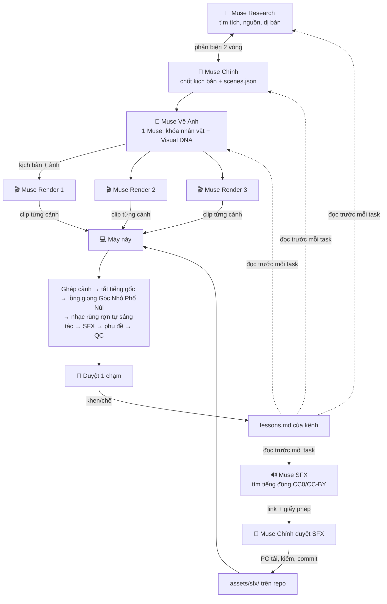

# Quy trình đội quân Muse làm video theo chủ đề

Áp dụng cho mọi kênh trong `channels/`. Ví dụ cụ thể: phim ma dân gian.

## Vai trò

| Muse | Việc | Nộp về Hub (`kind`) |
| :--- | :--- | :--- |
| Research | Tìm tích truyện, nguồn, dị bản; phản biện bản nháp của Muse Chính | `topic_research`, `script_rebuttal` |
| Chính | Viết + chốt kịch bản, `scenes.json`, duyệt SFX, tổng kết bài học | `script_final`, `sfx_review`, `lessons_update` |
| Vẽ ảnh (1) | Vẽ toàn bộ ảnh theo 1 bộ nhân vật khóa cứng (tránh lệch mặt giữa các cảnh) | `scene_images` (link ảnh) |
| Render (3) | Chia cảnh đều cho 3 Muse, mỗi Muse dựng clip từ ảnh + chuyển động trong `scenes.json` | `scene_clips` (link clip) |
| SFX (1) | Tìm tiếng động đúng danh sách cảnh cần, chỉ nhận nguồn có giấy phép rõ | `sfx_candidates` |

Muse **không push GitHub**. Media gửi bằng link (Drive / host tạm qua `bridges/file_exchange.py`). Máy này tải về, kiểm, rồi mới commit.

## Phần máy này làm

1. Tải clip 3 Muse render, xếp đúng thứ tự cảnh, ghép (`ffmpeg concat`).
2. **Tắt hoàn toàn tiếng gốc** của clip (`-an`).
3. Lồng giọng **Góc Nhỏ Phố Núi**: VieNeu-TTS `v3turbo` clone từ `giong_dalat_chua_lanh_ref.wav` (cùng cấu hình kênh KENH_012; chỉ đọc thư mục Tầng 1). Giọng ma = cùng giọng, hạ 3 nửa cung + vang.
4. Nhạc nền **tự sáng tác**: `studio/horror_music.py --seed <số tập>` (mỗi tập một bản, không bản quyền).
5. SFX từ `assets/sfx/` theo mốc thời gian trong `scenes.json`.
6. Trộn: nhạc tự nhỏ khi có lời (`sidechaincompress`), chuẩn −15 LUFS; phụ đề `.ass`; nhãn AIGC.
7. QC máy (`bridges/qc_engine.py`) → contact sheet → Muse Chính soi → gửi Telegram duyệt.

## Thư viện SFX ngày càng tốt hơn

- `assets/sfx/manifest.json` ghi mỗi tiếng: tên, nguồn, giấy phép, độ dài, độ lớn, điểm đánh giá, số lần dùng.
- Muse SFX đề xuất → Muse Chính chấm → máy kiểm (giấy phép, ≤ 1 MB, chuẩn loudness) → commit.
- Tiếng mới tốt hơn **thay thế** tiếng cũ cùng loại (giữ lịch sử trong git), tiếng bị chê nhiều bị gỡ.

## Kiến thức càng ngày càng tiến bộ

- Mỗi kênh có `channels/<kênh>/lessons.md`. Sau mỗi video: lý do duyệt/chê → 1–3 dòng bài học.
- Mọi đề bài gửi Muse tự đính kèm 20 bài học mới nhất của kênh + bài học chung.
- Lỗi lặp lại ≥ 2 lần → thành luật cứng trong QC (máy tự chặn).
